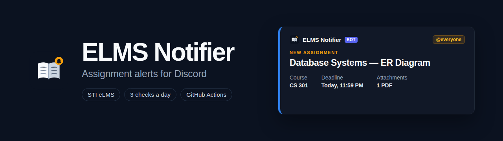
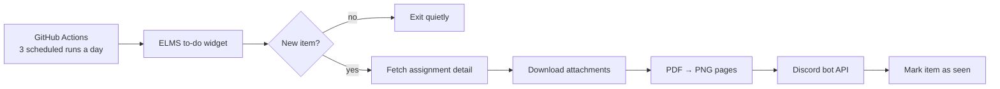

<p align="center">
  
</p>

<p align="center">
  <a href="https://www.python.org/"></a>
  <a href="https://discord.com/developers/docs"></a>
  <a href=".github/workflows/elms-notifier.yml"></a>
  <a href="LICENSE"></a>
</p>

# ELMS Notifier

**A free, open-source Discord bot that watches STI eLMS for new assignments and posts them to your server.**

ELMS Notifier reuses a Microsoft browser session that you sign into once, reads the STI eLMS to-do list, and sends each new assignment to Discord with its course, title, deadline, a direct link, PDF pages as PNGs, and the original PDF. It runs on a schedule in GitHub Actions — no paid APIs, no credit card, and no process running on your laptop all day.

> **Read-only by design.** It never submits, edits, deletes, enrolls, or clicks anything that changes data on the LMS. It only opens pages and downloads assignment attachments.

---

## Contents

- [Why this exists](#why-this-exists)
- [What it sends](#what-it-sends)
- [How it works](#how-it-works)
- [Requirements](#requirements)
- [Quick start](#quick-start)
- [Set up the Discord bot](#1-set-up-the-discord-bot)
- [Sign in to ELMS once](#2-sign-in-to-elms-once)
- [Test and create the baseline](#3-test-and-create-the-baseline)
- [Deploy with GitHub Actions](#deploy-with-github-actions)
- [Schedule](#schedule)
- [Configuration](#configuration)
- [Security and privacy](#security-and-privacy)
- [Troubleshooting](#troubleshooting)
- [Project structure](#project-structure)
- [Testing](#testing)
- [Maintainers](#maintainers)
- [License](#license)

---

## Why this exists

STI eLMS is the student portal many STI students use for assignments, surveys, and offline work. Checking the to-do list repeatedly is easy to forget, especially when a deadline is added between classes.

ELMS Notifier turns that to-do list into a quiet Discord feed:

- **One message per new item**, not a wall of repeated updates.
- **Deadlines become Discord timestamps**, so every member sees the deadline in their own local time.
- **PDFs arrive as PNG pages plus the original file**, ready for quick reading on a phone.
- **Failures are visible.** An expired session or an unreadable page sends an alert instead of failing silently.

It is built for a single student account on `elms.sti.edu`. It is not a multi-user service, a grade tracker, or an auto-submitter.

## What it sends

For every newly detected to-do item:

- A Discord embed with the **course**, **title**, **deadline**, and an **Open in ELMS** link.
- A live Discord timestamp when the deadline can be parsed; the raw ELMS deadline text is shown underneath.
- PDF attachments converted to **PNG pages**, batched to respect Discord's attachment limits.
- The **original PDF** (or other attachment).
- `@everyone` on the **first message of each new item** only. Alerts and file batches do not ping.

The first run is a **silent baseline**: it records the current to-do list without posting old items. Later runs post only items whose stable ELMS ID is not already in `state.json`.

Surveys and offline assignments are included because ELMS counts them in the same to-do widget. The message label says `survey` or `offline assignment` instead of `assignment`.

## How it works



1. **Read the to-do widget.** `/user_to_do_widget/tasks` returns the course list as server-rendered HTML. In CI this works with the saved ELMS cookies over plain HTTPS, so no browser is launched on the runner.
2. **Fetch each course's due page** and parse assignment rows into stable IDs.
3. **Diff against `state.json`.** Only IDs that have not been delivered are processed. The state is saved in the GitHub Actions cache between runs.
4. **Fetch the detail page** for each new item and parse the course, title, deadline, and attachments.
5. **Convert PDFs to PNGs** with PyMuPDF. Pages are batched to stay within Discord's 10-attachment and 8 MiB message budget.
6. **Send through the Discord bot API.** An item is marked seen only after its message is delivered successfully; failed items are retried on later runs.

The browser is used for the **one-time Microsoft sign-in** on your machine. CI can optionally reuse that saved Microsoft SSO session to renew ELMS cookies headlessly. The notifier never enters Microsoft credentials or handles MFA.

## Requirements

- Linux or macOS with **Python 3.12** (Windows is possible but the login helper is written for a graphical desktop session).
- A **graphical desktop session** for the one-time Microsoft sign-in.
- A **Discord server** where you can add your own bot.
- A **GitHub account** for the free scheduled workflow.

You do **not** need a paid server, a credit card, a domain, or a 24/7 process.

## Quick start

```bash
git clone https://github.com/<your-user>/<your-repo>.git
cd <your-repo>

python3.12 -m venv .venv
source .venv/bin/activate
pip install -r requirements.txt
python -m playwright install chromium

cp .env.example .env
# Edit .env with your bot token and channel ID.
```

Then follow the three setup sections below. The short version:

```bash
python scripts/recon.py --login-only   # sign in to ELMS manually
python src/main.py --test-discord      # verify the bot
python src/main.py --dry-run           # inspect without posting
python src/main.py                     # create the silent baseline
```

## 1. Set up the Discord bot

1. Open the [Discord Developer Portal](https://discord.com/developers/applications), create an application, and open **Bot**.
2. Click **Reset Token** and copy the token. Treat it like a password: never commit it, paste it into an issue, or screenshot it.
3. Open **OAuth2 → URL Generator**. Select the `bot` scope and these permissions:
   - **View Channels**
   - **Send Messages**
   - **Embed Links**
   - **Attach Files**
   - **Mention Everyone**
4. Open the generated URL and add the bot to your server.
5. In Discord, enable **Settings → Advanced → Developer Mode**, right-click the target channel, and choose **Copy Channel ID**.
6. Put both values in `.env`:

```dotenv
DISCORD_BOT_TOKEN=your-bot-token
DISCORD_CHANNEL_ID=123456789012345678
```

`.env` is gitignored. The bot does not need privileged intents or a gateway connection. It appears **offline between scheduled runs**, which is expected: the notifier uses Discord's REST API only while sending a message.

> If the bot lacks **Mention Everyone**, the message still posts but the ping is silently dropped.

## 2. Sign in to ELMS once

Run this from a terminal inside your Linux/macOS desktop session, **not over SSH**:

```bash
source .venv/bin/activate
python scripts/recon.py --login-only
```

A visible Chromium window opens. Sign in with your STI Microsoft account (including MFA), wait until the ELMS dashboard appears, then press Enter in the terminal. The helper saves the reusable session to `.session/storage-state.json` (gitignored).

The notifier never asks for or stores your password, and never enters Microsoft credentials or handles MFA. When the session expires, use `python scripts/refresh_session.py` (see [Refresh an expired session](#4-refresh-an-expired-session)). CI can renew automatically while the saved Microsoft SSO session is still valid.

For GitHub Actions, export only the ELMS cookies:

```bash
python scripts/export_cookies.py
```

This writes `.session/cookies.json` with the minimal cookie jar. The file is a credential and must stay private.

Optional: store the Microsoft SSO cookies so CI can renew the ELMS session without a manual login:

```bash
python scripts/refresh_session.py --export-sso | gh secret set ELMS_SSO_COOKIES
```

#### Automatic cookie rotation (recommended)

The workflow can write both refreshed cookie jars back to GitHub after every successful renewal. Create a GitHub App with **Repository permissions → Secrets: Read and write**, install it on this repository, then add two repository secrets:

- `APP_CLIENT_ID` — the App's Client ID
- `APP_PRIVATE_KEY` — the App's downloaded private key

The workflow mints a one-hour installation token and uses it only for `gh secret set`. If the App is not configured, the refresh still runs and the notifier falls back to the existing `ELMS_COOKIES`.

There is no non-expiring Microsoft cookie. `ESTSAUTHPERSISTENT` is valid for up to 90 days of inactivity; a successful renewal every few hours slides that window forward. If Microsoft revokes the session or requires MFA again, a manual sign-in is unavoidable.

## 3. Test and create the baseline

```bash
# Send one harmless bot message (no @everyone ping).
python src/main.py --test-discord

# Scrape and print what would be sent. Does not post or change state.
python src/main.py --dry-run

# Record the current to-do list as seen. Posts nothing on a fresh state.
python src/main.py
```

`--dry-run` on a fresh install prints `Would create a silent baseline with N item(s).` A normal first run prints a baseline log line and sends no assignment messages.

## Deploy with GitHub Actions

GitHub Actions runs the notifier three times a day in GitHub's cloud. A public repository gets unlimited standard-runner minutes, so this costs **₱0** and needs no payment card. Private repositories also work; three runs a day is far below the free quota.

### 1. Push the repository

Before pushing, confirm the private files are ignored:

```bash
git status --short
```

`.env`, `.session/`, `state.json`, `recon/`, `downloads/`, and `.venv/` must not appear. The included `.gitignore` covers them.

### 2. Add repository secrets

```bash
# Paste the bot token only when gh prompts. Never commit it.
gh secret set DISCORD_BOT_TOKEN

# The channel ID is not sensitive, but keeping it here is convenient.
gh secret set DISCORD_CHANNEL_ID

# The exported ELMS cookie jar.
gh secret set ELMS_COOKIES < .session/cookies.json
```

You can also add these in **Settings → Secrets and variables → Actions**.

### 3. Run it once manually

```bash
gh workflow run elms-notifier.yml
gh run watch
```

The first run has no cached state, so it creates a **silent baseline**. That is expected. Check the log for:

```text
Baseline created with N items; no notifications sent.
```

After that, new items produce one bot message each. State is saved in the Actions cache even when the notifier exits non-zero, so failed items can be retried.

### 4. Refresh an expired session

CI tries `ELMS_SSO_COOKIES` first. If Microsoft still has a valid SSO session, renewal is automatic.

When the bot posts a session-expired alert, refresh manually:

```bash
source .venv/bin/activate
python scripts/refresh_session.py
python scripts/refresh_session.py --export-sso | gh secret set ELMS_SSO_COOKIES
```

This opens a dedicated browser profile. If the session is still valid, it exports immediately. If it expired, sign in manually (including Microsoft MFA). The script prints the signed-in account name, asks you to confirm it is the right account, then writes `.session/cookies.json` and updates the `ELMS_COOKIES` GitHub secret. The `--export-sso` command refreshes the cookies used for automatic renewal.

Use `--no-secret` to skip the GitHub update or `--repo owner/name` to target a different repository. The helper never enters credentials or handles MFA.

The next scheduled run uses the new cookies. No code changes are needed.

Full deployment notes, limits, and a troubleshooting table: [`docs/GITHUB_ACTIONS.md`](docs/GITHUB_ACTIONS.md).

## Schedule

The workflow runs at:

| Philippine Time (UTC+8) | UTC cron |
|---|---|
| **10:31 AM** | `02:31` |
| **1:31 PM** | `05:31` |
| **10:31 PM** | `14:31` |

The cron expression is `31 2,5,14 * * *` in [`.github/workflows/elms-notifier.yml`](.github/workflows/elms-notifier.yml). The 31-minute offset avoids GitHub's busy top-of-hour scheduling window. GitHub scheduled runs can still be delayed under load; this is not a real-time monitor.

## Configuration

| Variable | Required | Default | Purpose |
|---|---|---|---|
| `DISCORD_BOT_TOKEN` | Yes | — | Bot token from the Discord Developer Portal. Never commit it. |
| `DISCORD_CHANNEL_ID` | Yes | — | Target Discord channel ID. |
| `ELMS_COOKIES_JSON` | CI/headless | — | Minimal ELMS cookie jar for browserless runs. |
| `ELMS_SSO_COOKIES_JSON` | Optional CI | — | Microsoft SSO cookies used for headless session renewal. |
| `ELMS_STATE_PATH` | No | `state.json` | Where the seen/failure state is stored. |
| `ELMS_DOWNLOAD_DIR` | No | `downloads/` | Temporary attachment download directory. |

The timezone is fixed to `Asia/Manila` so deadlines and the schedule behave consistently.

## Security and privacy

- **Read-only on ELMS.** The notifier opens pages and downloads attachments. It never submits forms, edits, deletes, enrolls, or performs any write action.
- **No credential automation.** The notifier never enters Microsoft credentials, handles MFA, solves captchas, or bypasses access controls. Optional headless renewal reuses an existing Microsoft SSO cookie and stops if Microsoft asks for a password or MFA.
- **Secrets stay out of the repository.** `.env`, `.session/`, `state.json`, and `downloads/` are gitignored. The bot token is read only from the environment or `.env`.
- **CI secrets are encrypted repository secrets.** `ELMS_COOKIES` contains the minimal cookie jar; `ELMS_SSO_COOKIES` contains the Microsoft SSO cookies used for renewal; `DISCORD_BOT_TOKEN` is the bot credential.
- **Logs are deliberately quiet.** The notifier logs item IDs and error types, not page HTML, instructions, cookies, tokens, or full attachment URLs.
- **Test fixtures are sanitized.** Raw ELMS HTML is never committed; fixtures use fake names, IDs, and course codes.
- **Minimum Discord permissions.** Grant only View Channels, Send Messages, Embed Links, Attach Files, and Mention Everyone.
- **If a token leaks,** reset it in the Discord Developer Portal and update the secret. If a cookie jar leaks, sign out the session and create a new one.

This project is not affiliated with STI Education Services Group or Discord Inc. Use it in line with your institution's acceptable-use policy.

## Troubleshooting

| Symptom | Likely cause | Fix |
|---|---|---|
| `No module named 'bs4'` | System Python, not the venv | `source .venv/bin/activate` or use `.venv/bin/python` |
| `DISCORD_BOT_TOKEN is not set` | Missing `.env` or secret | Set the token locally and in repository secrets |
| `Discord returned HTTP 401` | Bad or revoked token | Reset the bot token and update the secret |
| `Discord returned HTTP 403` | Missing channel permissions | Grant Send Messages, Embed Links, Attach Files |
| `Discord returned HTTP 404` | Wrong channel ID or bot not in server | Copy the channel ID again; re-invite the bot |
| Message posts but `@everyone` does not ping | Missing Mention Everyone | Grant that permission in the channel |
| `Session expired` alert | Cookies expired or rejected | Run `python scripts/refresh_session.py`, then `python scripts/refresh_session.py --export-sso \| gh secret set ELMS_SSO_COOKIES` |
| `Microsoft SSO did not complete` | SSO cookies expired or Microsoft wants MFA | Sign in manually, then re-export `ELMS_SSO_COOKIES` |
| Empty to-do list alert | Session or page layout changed | Run `--dry-run`; check the session and selectors |
| No new notifications | Items are already in the baseline | Check `state.json`; this is expected for old items |
| PDF too large | Page exceeds Discord's file limit | The bot lowers DPI 130 → 100 → 80 and batches pages |
| Workflow stopped running | Public-repo schedule disabled after 60 days of inactivity | Make a commit or run the workflow manually |
| First run after cache eviction posts nothing | A new silent baseline was created | Check ELMS manually for items added during the gap |

## Project structure

```text
.
├── assets/                     # Logo and README/social images
├── docs/
│   └── GITHUB_ACTIONS.md       # Deployment, limits, and troubleshooting
├── scripts/
│   ├── export_cookies.py       # Export the minimal CI cookie jar
│   ├── recon.py                # Manual ELMS login + optional recon capture
│   └── refresh_session.py      # One-command sign-in + secret refresh
├── src/
│   ├── auth.py                 # Browser and cookie-backed sessions
│   ├── config.py               # Environment, paths, limits
│   ├── discord_notify.py       # Bot API delivery, embeds, attachments
│   ├── main.py                 # Orchestration only
│   ├── models.py               # Dataclasses
│   ├── pdf_tools.py            # Download, PDF → PNG, batching
│   ├── scraper.py              # To-do, due-page, and detail parsing
│   ├── selectors.py            # All ELMS selectors and URLs
│   └── state.py                # Seen/failure state and diffing
├── tests/                      # Pytest suite and sanitized fixtures
├── .github/workflows/
│   ├── elms-notifier.yml       # Scheduled notifier
│   └── tests.yml               # Tests on push and pull request
├── .env.example
├── .gitignore
├── CONTRIBUTING.md
├── LICENSE
├── MAINTAIN.md
├── README.md
├── SECURITY.md
├── pytest.ini
├── requirements.txt
└── requirements-cloud.txt
```

## Testing

```bash
source .venv/bin/activate
pytest -q
```

The suite covers parsing with and without deadlines, attachment handling, PDF batching, state diffing, first-run baseline behavior, session expiry, and Discord bot payloads. Fixtures in `tests/fixtures/` are sanitized fakes; raw ELMS captures stay in the gitignored `recon/` directory and are never committed.

## Maintainers

- [`MAINTAIN.md`](MAINTAIN.md) — architecture, selectors, state model, session refresh, release checklist, and repository metadata.
- [`CONTRIBUTING.md`](CONTRIBUTING.md) — local development, tests, and fixture sanitization rules.
- [`SECURITY.md`](SECURITY.md) — how to report a vulnerability and how secrets are handled.

## License

MIT — see [`LICENSE`](LICENSE).

---

<p align="center">
  Built for students who would rather see the deadline than remember to check for it.
</p>
